# profit-split-api

5명이 쓰는 **주간 수익 정산 웹앱**을 Google Apps Script에서 **NestJS + MySQL + React**로 옮기고, AWS EC2에 Docker Compose로 직접 배포한 프로젝트입니다.

## 배경

5명이 Google Apps Script로 만든 정산 웹앱을 쓰고 있었습니다.
- 데이터는 주마다 JSON 한 덩어리로 시트에 저장했습니다.
- 확정한 주는 화면에서만 잠갔습니다.
- 동시에 저장하는 요청은 `LockService`로 한 줄로 세웠습니다.

백엔드와 배포를 직접 경험해 보려고 같은 기능을 NestJS + MySQL + React로 다시 만들었습니다. 기존 시트 데이터를 옮긴 뒤 정산 결과가 1원 단위까지 같은지 대조했습니다.

정산 규칙은 다음과 같습니다.
- 분배율 = 원자재 기여 비율의 50% + 기본 몫(5명이 50%를 균등하게, 1인당 10%)
- 판매 수수료 5%
- 지출은 원금의 105%로 반영

레포에는 멤버 실명과 실제 정산 데이터가 없습니다. 문서와 테스트의 숫자는 예시 값입니다.

## 전후 비교

| 항목 | 기존 (Apps Script) | 지금 |
|---|---|---|
| 데이터 구조 | 주마다 JSON 한 덩어리 | 테이블 4개(members, weeks, contributions, expenses), unique 3개, FK 4개 |
| 동시 수정 | `LockService`로 쓰기 직렬화 | `version` 조건부 UPDATE. 충돌하면 `409` + 최신 값 |
| 무결성 | JSON 안의 값은 DB 제약 없음 | DB 제약 + `class-validator` 입력 검증(음수, 소수, 허용 안 된 필드는 400) |
| 확정 잠금 | 화면에서만 잠금 | 서버가 판단. 확정일 00:00 KST가 지나면 자동 잠금, 수동 잠금/해제 가능 |
| 접근 제어 | 웹앱 링크만 있으면 누구나 수정 가능 | 공용 접속 코드 + 서명 쿠키 + IP별 실패 제한 |
| 스키마 관리 | 없음 (JSON) | TypeORM 마이그레이션 (`synchronize` 끔) |
| 테스트 | 없음 | Jest 단위 테스트 56개, 시트 대조 스크립트, headless 브라우저 확인 |
| 화면 | Apps Script HTML | React 19 + Vite, 휴대폰 우선 |
| 배포 | Apps Script 웹앱 배포 | AWS EC2 한 대 + Docker Compose + Caddy, GitHub Actions CI |

## 아키텍처

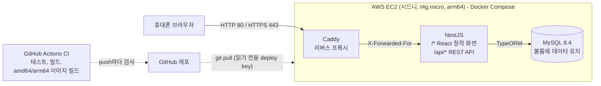

- 외부에 열린 포트는 Caddy의 80/443뿐입니다. app과 MySQL은 Compose 내부 네트워크에서만 통신합니다.
- 컨테이너 시작 순서: MySQL healthy → 마이그레이션 → (빈 DB면) 멤버 seed → 앱 시작 → Caddy.

## 기술 스택

| 영역 | 사용 기술 |
|---|---|
| API | NestJS 12, TypeScript, class-validator |
| DB | MySQL 8.4, TypeORM 1.1 (마이그레이션) |
| 화면 | React 19, Vite 8 |
| 테스트 | Jest, headless Edge + Chrome DevTools Protocol 스크립트 |
| 배포 | Docker 멀티 스테이지 빌드, Docker Compose, Caddy 2 |
| 인프라 | AWS EC2 t4g.micro (arm64, Ubuntu 24.04, 시드니 리전), 탄력적 IP |
| CI | GitHub Actions |

## 주요 설계 결정과 이유

### 1. 정규화, 정산 결과는 저장하지 않음

- 주차, 멤버별 원자재, 지출을 각각 테이블로 나눴습니다. `weeks(confirmDate)`, `contributions(weekId, memberId)`에 unique를 걸어 같은 주나 같은 칸이 두 번 생기지 않습니다.
- 정산 결과는 저장하지 않고, 요청마다 입력값으로 계산합니다. 입력이 바뀌었는데 결과가 옛 값으로 남는 일이 없습니다.

### 2. 낙관적 락: 조건부 UPDATE 한 문장

- 수정 요청은 읽었을 때의 `version`을 함께 보냅니다.
- 서버는 `UPDATE ... SET ..., version = version + 1 WHERE id = ? AND version = ?` 한 문장으로 씁니다. 바뀐 행이 0개면 `409 VERSION_CONFLICT`와 최신 데이터(`current`)를 돌려줍니다.
- **`save()`를 쓰지 않은 이유**: TypeORM 1.1.2 소스를 확인해 보니, `@VersionColumn`이 있어도 `save()`의 UPDATE는 WHERE에 기본키만 넣고 version은 올리기만 합니다. 그래서 "읽고 → 비교하고 → `save()`" 방식은 비교와 저장 사이에 다른 요청이 끼어들면 그대로 덮어씁니다.
- 아직 행이 없는 칸(version 0)은 insert하고, 그사이 다른 요청이 먼저 만들었으면 unique 충돌을 409로 바꿉니다.
- 화면은 409를 받으면 `current`로 다시 그리고, 사용자가 입력했던 값을 안내에 남깁니다.

### 3. 마이그레이션으로 전환 (`--fake`, `--check`)

- `synchronize`는 어떤 SQL이 실행될지 미리 볼 수 없고, 서버를 띄우기만 해도 운영 테이블이 바뀝니다. 그래서 끄고 마이그레이션으로만 스키마를 바꿉니다.
- 이미 테이블이 있던 개발 DB는 `migration:run --fake`로 "적용됨"만 기록했습니다. 그 전후로 `migration:generate --check`로 "변경 없음"을 확인하고, 덤프 diff로 데이터가 그대로인 것을 확인했습니다.
- 자동 생성 SQL은 매번 검토합니다. 다음 두 경우는 손으로 작성했습니다.
  - 컬럼 이름 변경이 "인덱스 삭제 → 이름 변경 → 인덱스 생성"으로 나온 경우: `RENAME COLUMN` + `RENAME INDEX`로 제약을 유지했습니다.
  - `confirmed`(boolean) → `manualLock`(null/true/false) 변경에 데이터 변환이 빠진 경우: 변환 규칙을 직접 넣었습니다.

### 4. 시트 데이터 이전과 1원 단위 대조

- 가져오기 스크립트(`import:sheet`)는 다음처럼 동작합니다.
  - `--dry-run`을 지원합니다.
  - 전체를 먼저 검증하고, 이상한 값이 하나라도 있으면 위치를 알려주고 아무것도 쓰지 않습니다.
  - 주차마다 트랜잭션으로 넣고, 다시 실행해도 중복되지 않습니다.
- 대조 스크립트(`verify:sheet`)는 시트가 계산해 둔 정산 결과와 새 API 결과를 주차마다 비교합니다.
- 실명이 들어 있는 원본 CSV는 `.gitignore`로 레포에서 뺐습니다. 멤버 이름은 이니셜로만 넣습니다.

### 5. 날짜의 의미: `confirmDate`

- 기존 앱의 주차 키는 "그 주의 확정일(화요일)"이었습니다. 처음에 `startDate`로 이름 붙였다가, 이름과 의미를 맞추려고 `confirmDate`로 바꿨습니다.
- "이번 주"는 오늘(KST) 이후 첫 화요일입니다. 브라우저 시간대와 관계없이 KST로 계산합니다.

### 6. 수동/자동 잠금

- 확정일 00:00 KST가 지나면 그 주의 **원자재 금액만** 잠깁니다. 판매 금액과 지출은 계속 고칠 수 있고, 잠금 해제는 누구나 할 수 있습니다 (팀원 합의).
- DB에는 수동 설정(`manualLock`: null=자동 / true / false)만 저장합니다. 잠김 여부는 요청마다 `manualLock ?? (지금 ≥ 확정일 00:00 KST)`로 계산합니다.
- 스케줄러로 화요일 00시에 값을 바꾸는 방식은 그 시각에 서버가 꺼져 있으면 틀리고, 자동/수동 구분도 사라집니다.
- 현재 시각을 주입받는 `Clock`으로 가져와서, 경계 시각(월 23:59:59.999 vs 화 00:00 KST)을 테스트했습니다.

### 7. 접속 코드와 무차별 대입 방어

- 회원가입 없이 팀이 공유하는 코드 하나로 들어옵니다 (팀원 합의).
- 코드가 맞으면 httpOnly 쿠키(HMAC-SHA256 서명, 30일)를 발급합니다. 서명에 코드를 넣어서, 코드를 바꾸면 기존 쿠키가 모두 무효가 됩니다.
- 코드와 서명은 `timingSafeEqual`로 비교합니다.
- IP별로 5번 연속 실패하면 15분 동안 `429`를 돌려줍니다.
- 코드나 32자 이상 비밀값이 환경변수에 없으면 서버가 시작하지 않습니다.

### 8. trust proxy = 1

- Caddy 뒤에서는 `req.ip`가 모두 Caddy IP가 되어, 한 명이 5번 틀리면 전원이 15분 막힙니다.
- `trust proxy = 1`은 바로 앞 프록시 하나만 믿습니다. 그래서 Caddy가 직접 본 접속 IP를 쓰고, 사용자가 지어낸 `X-Forwarded-For` 앞부분은 무시합니다.
- 로컬에서 지어낸 헤더를 보내 확인했습니다. 앱 로그에는 실제 접속 IP가 찍혔습니다.
- 프록시 없이 열린 서버에서 켜면 헤더로 IP를 바꿀 수 있어서, 배포용 compose에서만 켭니다.

### 9. 1GB 서버에 맞춘 메모리 조정

- MySQL 기본 설정은 혼자 400MB 넘게 쓸 수 있습니다. 1GB 서버에 맞게 줄였습니다.
  - `performance-schema=OFF`
  - `innodb-buffer-pool-size=64M`
  - `max-connections=30`
  - 캐시와 버퍼 크기 축소
- 서버에서 빌드할 때(npm ci, vite)는 메모리가 더 필요해서 스왑 2GB를 둡니다.

## 측정 결과

| 항목 | 결과 |
|---|---|
| 동시 수정 (같은 칸, 같은 version, 서로 다른 값 10개 동시 전송 × 5회) | 변경 전: 50개 모두 200, 그중 **45개 입력이 알림 없이 사라짐** → 변경 후: 200 5개, 409 45개, **잃어버린 입력 0개** |
| 시트 대조 (3주 × 5명) | 멤버별 정산액 **15/15 일치**(1원 단위), 분배율 15/15, 합계 9/9 |
| 단위 테스트 | **56개** 통과 (9 suites) |
| 컨테이너 메모리 (로컬 측정) | MySQL 약 140MB, app 약 85MB, Caddy 약 12MB (합 약 250MB) |
| CI 시간 (GitHub Actions) | 전체 **1분 40초** (test-build 32초, docker 54초) |

## 막혔던 부분과 해결

| 문제 | 원인 | 해결 |
|---|---|---|
| `@VersionColumn`이 있는데 동시 수정이 덮어써짐 | `save()`는 UPDATE의 WHERE에 version을 넣지 않음 | QueryBuilder 조건부 UPDATE 한 문장 + affected 0이면 409 |
| 컬럼 이름 변경 마이그레이션에서 unique 제약이 잠깐 사라짐 | 자동 생성 SQL이 인덱스 삭제 → 변경 → 재생성 순서 | `RENAME COLUMN` + `RENAME INDEX`로 손으로 작성 |
| `confirmed` → `manualLock` 자동 생성 SQL에 데이터 변환 없음 | 이름만 바꾸면 `false`가 "수동 해제"가 되어 자동 잠금이 안 됨 | 변환 규칙을 넣어 손으로 작성, 임시 DB에서 4가지 경우 확인 |
| `tsc --noEmit`에서만 보이는 타입 에러 | `nest build`와 ts-jest는 spec 파일 타입을 다르게 검사 | mock 객체에 타입 지정 |
| Caddy 컨테이너가 계속 재시작 | `DOMAIN=`(빈 값)이면 `{$DOMAIN::80}`이 빈 주소가 됨 | compose에서 셸 기본값 `${DOMAIN:-:80}`으로 넘김 |
| Docker Desktop에서 멀티 아키텍처 빌드 실패 | 기본 docker 드라이버는 multi-platform 미지원 | `docker-container` 드라이버 빌더 사용 (CI도 같은 방식) |
| 한글 지출 항목이 깨져 보임 | git bash의 curl이 요청 본문을 CP949로 보냄 | node `fetch`(UTF-8)로 다시 확인, 백업/복원 후 바이트까지 같음 |
| 로그인 실패 제한이 서버 재시작으로 풀림 | 실패 기록이 메모리에 있음 | 한계로 문서화 (아래 "알려진 한계") |

## 배포 과정

AWS EC2(시드니 리전, t4g.micro, Ubuntu 24.04 arm64) 한 대에 Docker Compose로 배포했습니다. 서버 주소는 `<서버IP>`로 표기합니다. 새 계정 Free plan은 리전이 시드니로 고정돼 있어서, 유료 전환 대신 시드니를 골랐습니다.

캡처는 계정 ID, 서버 IP, 접속한 곳의 IP가 보이지 않게 자르거나 가렸습니다.

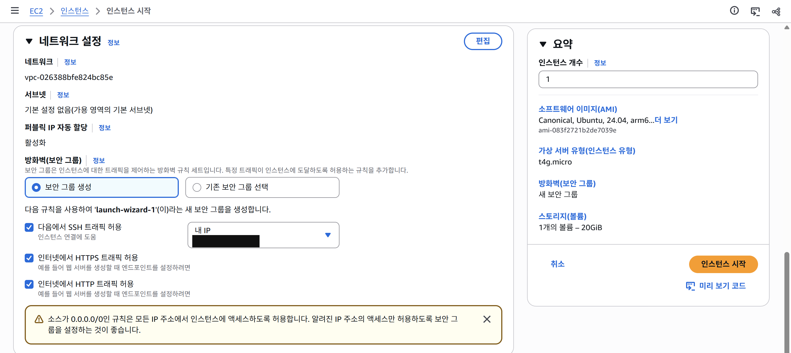
인스턴스 유형 t4g.micro(Arm, 프리 티어 대상), Ubuntu 24.04, 디스크 20GiB gp3. SSH는 내 IP만, HTTP/HTTPS는 공개.

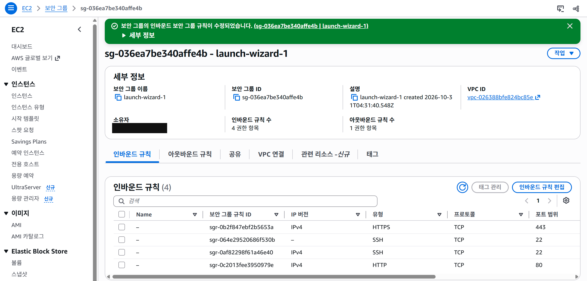
인바운드 규칙 4개: HTTPS 443, HTTP 80, SSH 22(내 IP), SSH 22(브라우저 터미널인 EC2 Instance Connect의 AWS 주소 목록만). 3306(MySQL), 3000(앱)은 열지 않았습니다.

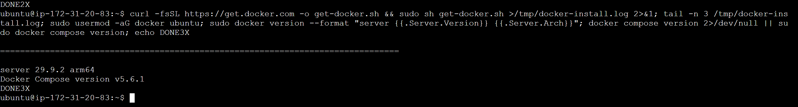
스왑 2GB를 만든 뒤 Docker 29.9.2(arm64)와 Docker Compose v5.6.1 설치. 비공개 레포는 서버에서 만든 키를 읽기 전용 deploy key로 등록해서 받았습니다.

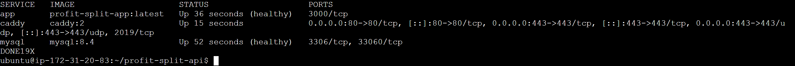
app, mysql은 healthy, caddy만 80/443을 외부에 연 상태.

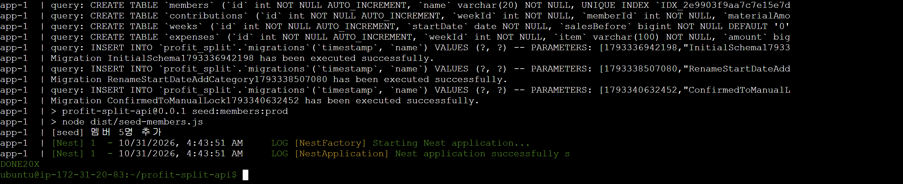
빈 DB에서 마이그레이션 3개 실행 → 멤버 5명 seed → Nest 앱 시작.

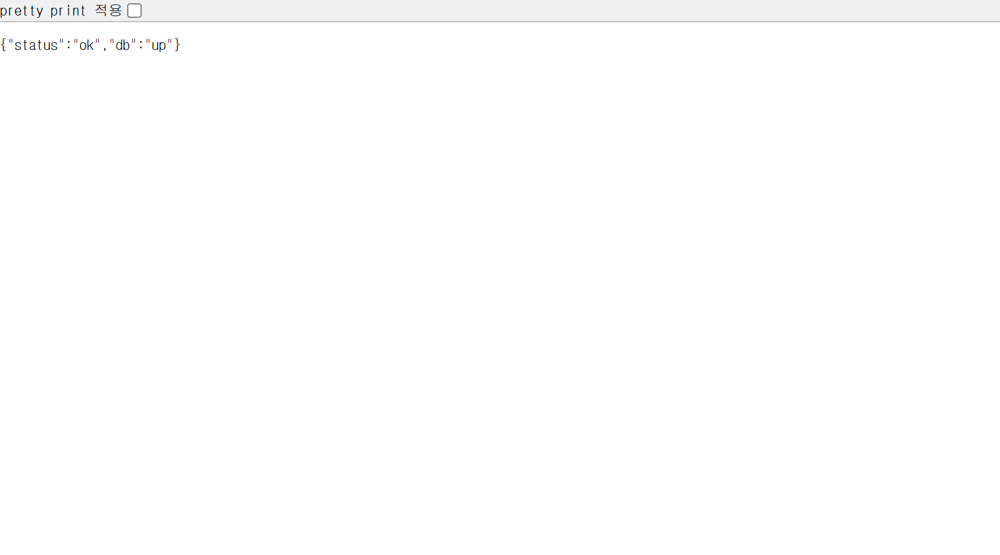
`http://<서버IP>/api/health` → `{"status":"ok","db":"up"}`.

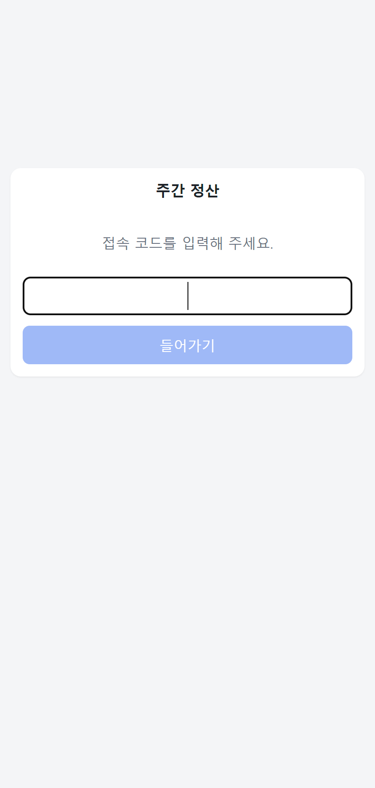
쿠키가 없을 때 보이는 접속 코드 화면.

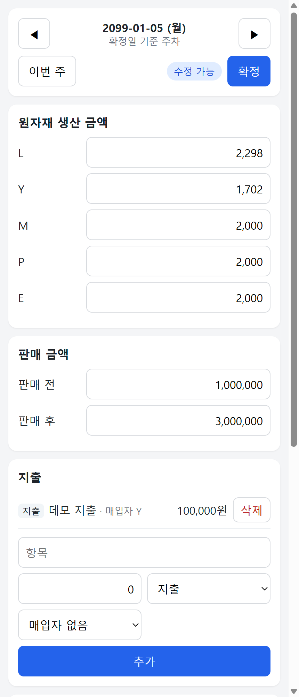
테스트 주차(2099-01-05)에 예시 값을 넣은 입력 화면. 멤버는 이니셜.

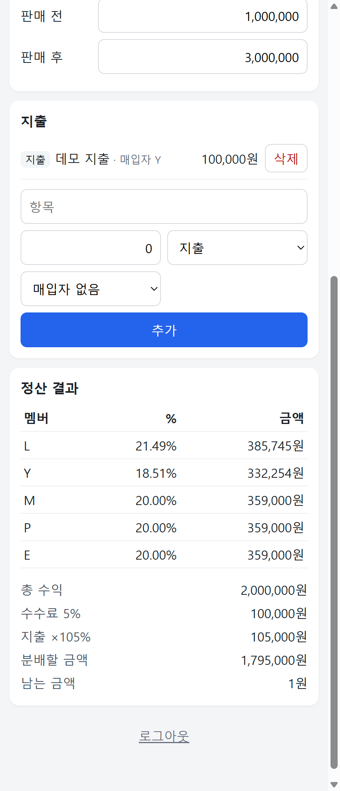
같은 주의 멤버별 분배율과 정산액, 총 수익, 수수료, 지출 ×105%, 분배할 금액. 로컬에서 같은 값으로 계산한 결과와 같고, 같은 서버에 오래된 version으로 수정 요청을 보내면 `409 VERSION_CONFLICT`가 나오는 것까지 확인했습니다.

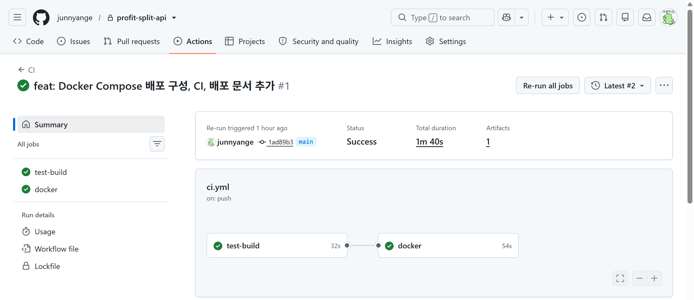
push 후 CI 성공: test-build 32초, docker 54초, 전체 1분 40초.

## 실행 방법

### 로컬 개발

```bash
docker compose up -d          # 개발용 MySQL (localhost:3307)
npm install
npm run migration:run
npm run start:dev             # API (http://localhost:3000/api)

cd web && npm install
npm run dev                   # 화면 (http://localhost:5173, /api는 3000으로 proxy)
```

환경변수, API 규칙, 마이그레이션 명령은 [docs/development.md](docs/development.md)를 참고하세요.

### 배포용 Docker Compose

```bash
cp .env.production.example .env.production   # 값 채우기
docker compose -f docker-compose.prod.yml up -d --build
docker compose -f docker-compose.prod.yml down   # 내리기 (데이터 볼륨 유지)
```

서버 준비, 도메인/HTTPS, 백업과 복원, 비용은 [docs/deploy.md](docs/deploy.md)에 순서대로 적었습니다.

## 알려진 한계와 남은 일

- **로그인 실패 기록이 메모리에 있음**: 컨테이너를 재시작하면 초기화되고, 서버를 여러 대로 늘리면 서버마다 따로 셉니다. 같은 공인 IP(같은 Wi-Fi)를 쓰는 사람끼리는 같이 막힙니다.
- **확정 직전 동시 수정 1건 통과 가능**: 원자재 잠금은 "읽고 확인" 방식이라, 확정과 거의 동시에 들어온 수정 1건은 통과할 수 있습니다. 막으려면 트랜잭션 + `SELECT ... FOR UPDATE`가 필요합니다.
- **실시간 갱신 없음**: 다른 사람이 고친 값은 내가 저장하거나 주를 옮길 때 보입니다 (저장 시점에는 409로 알 수 있음).
- **매입자별 미정산 합계 미구현**: 기존 앱에 있던 기능입니다. 받을 돈 = 지출 원금으로 정했고, 구현은 아직입니다.
- **HTTPS**: 도메인을 연결하면 Caddy가 인증서를 자동 발급하는 구성이지만, 실제 도메인 연결은 아직입니다.
- **백업은 서버 디스크에만 쌓임**: 서버 밖 복사는 사람이 직접 해야 합니다.
- **실제 휴대폰 확인 부족**: headless 브라우저(휴대폰 크기)로만 확인했습니다.

## AI 활용 방식

이 프로젝트는 AI 에이전트 두 개와 사람이 역할을 나눠 진행했습니다.

| 누가 | 한 일 |
|---|---|
| Claude Code (VS Code) | 지시문을 받아 코드 구현, 테스트, 측정, 작업 기록([worklog](docs/worklog.md)) |
| Aside (브라우저 AI 에이전트) | 설계, 지시문 작성, 결과 검토와 브라우저 교차 검증, 원본 Apps Script 계산식과 시트 데이터 확보, AWS 콘솔 작업과 배포 증거 캡처 |
| 사람 | 방향과 기술 선택, 팀원 합의(접속 코드, 원자재만 잠금, 해제는 누구나), 개인정보 원칙(이니셜, 실제 데이터 미업로드), 비용 결정(Free plan, 시드니 리전), 커밋 |

지시문에는 매번 다음을 넣었습니다.
- **금지 사항**: 예를 들어 `.env` 수정, 커밋, 계산식 변경, 실제 주차에 쓰기.
- **검증 기준과 측정**: 예를 들어 동시 요청 10개의 기대 결과, 시트 대조 일치 건수.
- **판단이 갈리면 먼저 묻기.**
- **단계마다 멈추고 worklog 남기기.**

## 검증 방식: 만든 쪽과 확인하는 쪽을 나눴습니다

AI가 "됐다"고 하는 것을 그대로 믿지 않고, 단계마다 다른 경로로 다시 확인했습니다.

1. **기준을 먼저 정함**: 지시문에 기대 결과를 적었습니다. 예) "같은 version으로 동시 요청 10개 → 200 1개, 409 9개", "정산액 1원 단위 일치".
2. **만든 쪽이 측정하고 기록**: Claude Code가 빌드, 테스트, 측정 결과를 [worklog](docs/worklog.md)에 남겼습니다.
3. **다른 쪽이 다시 확인**: Aside가 worklog와 코드를 읽고, 서버를 띄운 뒤 브라우저로 직접 호출했습니다. 정산 결과는 손으로 계산한 값과 대조했습니다.
4. **원본과 대조**: 계산식은 기존 Apps Script 소스에서 그대로 가져왔고, 결과는 기존 앱의 실제 정산 기록과 비교했습니다.
5. **환경이 바뀔 때마다 다시**: 로컬 개발 서버 → 로컬 Docker Compose → AWS 서버에서 같은 예시 값으로 같은 정산 결과와 409를 다시 확인했습니다.
6. **검증 방법도 검증**: 공개 전 비밀값 점검을 GitHub 코드 검색으로 하려다가, 확실히 있는 코드를 넣어도 0건이 나오는 것을 보고(대조 검색) 그 방법을 버렸습니다. git 히스토리 전체 검사로 바꿨습니다.

| 단계 | 확인한 것 | 결과 |
|---|---|---|
| 정산 로직 이식 | 원본 계산식, 실제 정산 기록 | 멤버별 정산액 1원 단위 일치 |
| API | 브라우저 직접 호출, 손 계산 대조, 잘못된 입력 | 정산 일치, 음수/소수 400, 없는 멤버 404, 없는 날짜 400 |
| 낙관적 락 | 동시 요청 10개 × 5회, 변경 전 코드와 비교 | 손실 45건 → 0건 |
| 마이그레이션 | `--check`, 덤프 diff, 임시 DB에서 run/revert/run | 변경 없음, 데이터 그대로 |
| 데이터 이전 | `verify:sheet` | 정산액 15/15, 분배율 15/15, 합계 9/9 |
| 화면 | 두 탭 동시 수정, 잠금, 오프라인 (headless 브라우저) | 18/18, 16/16 통과 |
| 배포 | 로컬 compose → EC2: 헬스체크, 로그인, 예시 주차 정산, 409 | 로컬과 같은 결과 |
| 공개 전 | git 히스토리 전체 + 현재 파일 | 실명, 비밀값, 키 파일 0건 |

틀린 것도 기록했습니다. 예를 들어 "컨럼 이름을 바꾸면 TypeORM이 DROP + ADD를 만든다"는 앞선 기록은 실제로 확인해 보니 `CHANGE`(이름 변경)였어서 [worklog](docs/worklog.md)에 정정했습니다.

## 개발 기록

단계별로 무엇을 만들었고, 왜 그렇게 정했고, 어떤 에러가 났는지를 [docs/worklog.md](docs/worklog.md)에 남겼습니다.
